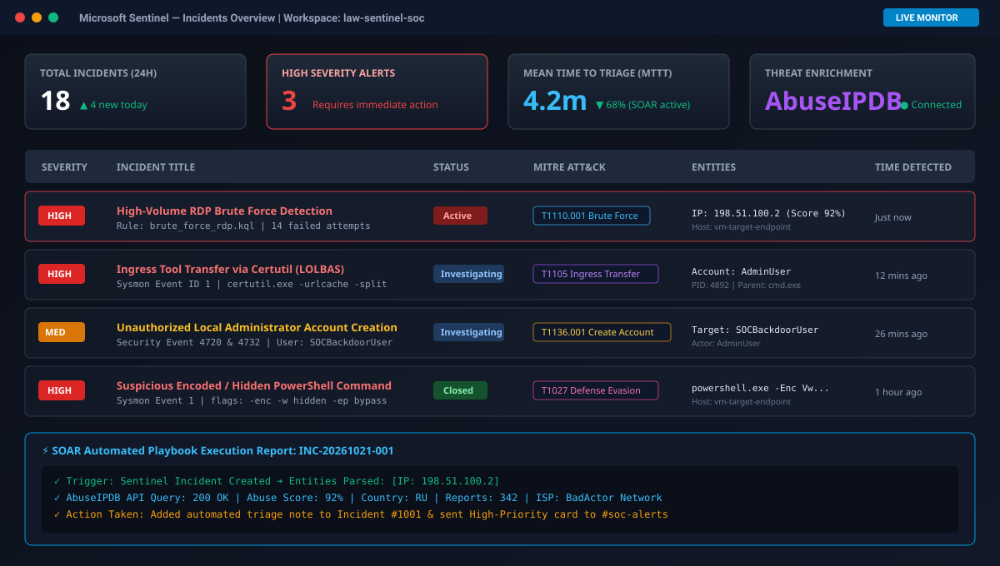
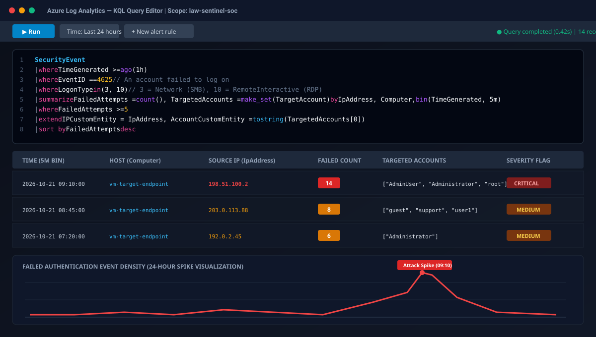
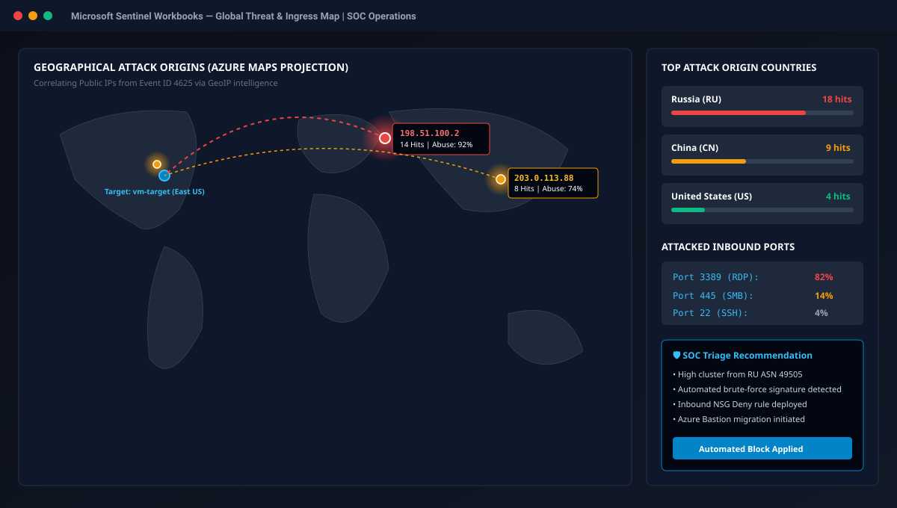
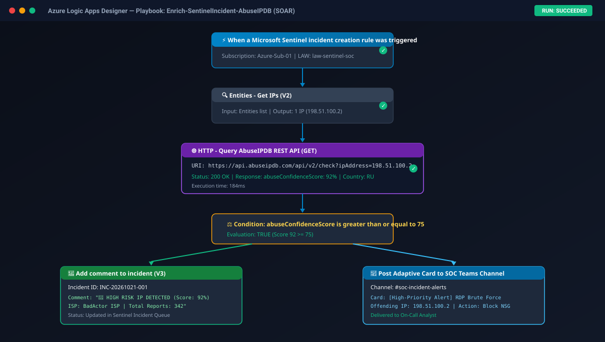

# Azure Sentinel Cloud SOC & Detection Engineering Lab

[](https://venu-3754.github.io/azure-sentinel-cloud-soc/)
[](https://azure.microsoft.com/en-us/products/microsoft-sentinel/)
[-orange?style=for-the-badge)](https://learn.microsoft.com/en-us/azure/data-explorer/kusto/query/)
[](https://attack.mitre.org/)
[](https://azure.microsoft.com/en-us/products/logic-apps/)

> **🌐 Live Interactive Demo:** Visit the live interactive SOC analyst dashboard and investigation console at:  
> **👉 [https://venu-3754.github.io/azure-sentinel-cloud-soc/](https://venu-3754.github.io/azure-sentinel-cloud-soc/)**

---

## 📌 Project Overview
The objective of this project is to simulate real-world SOC analyst workflows:
1. **Telemetry Ingestion**: Ingesting endpoint security logs and Sysmon telemetry via Azure Monitor Agent (AMA).
2. **Adversary Simulation**: Executing controlled attack techniques mapped to the MITRE ATT&CK framework (Credential Access, Execution, Persistence, Defense Evasion).
3. **Detection Engineering**: Authoring custom Kusto Query Language (KQL) scheduled analytics rules to detect malicious behavior with minimal false positives.
4. **SOAR Automation**: Building an automated triage playbook using Azure Logic Apps to query threat intelligence (AbuseIPDB API) and alert the SOC team.
5. **Incident Investigation**: Conducting root cause analysis and writing standardized SOC incident reports.

---

## 📸 Visual Telemetry & Dashboard Screenshots

### 1. Microsoft Sentinel Incident Queue & Live Alert Triage
Visualizing active high-severity alerts, MITRE technique tagging, offending IP entities, and automated SOAR run statuses.



---

### 2. KQL Query Investigation & 24-Hour Attack Spike Analysis
Executing custom KQL queries in Azure Log Analytics to isolate failed logon clusters with rolling 5-minute bins and entity aggregation.



---

### 3. Microsoft Sentinel Global Threat Map & Ingress Visualization
Interactive Azure Maps workbook plotting brute-force attack origins across geographic regions with automated NSG block recommendations.



---

### 4. Azure Logic Apps SOAR Playbook Execution (AbuseIPDB Enrichment)
Automated incident workflow parsing the offending IP, querying the AbuseIPDB REST API (Score: 92%), updating Sentinel incident comments, and alerting the on-call SOC analyst.



---

## 🎯 Simulated MITRE ATT&CK Techniques & Detections

| Technique ID | Technique Name | Tactic | Event Source | Detection Query |
|---|---|---|---|---|
| **T1110.001** | Brute Force: Password Guessing | Credential Access | Windows Security (4625) | [`detections/brute_force_rdp.kql`](detections/brute_force_rdp.kql) |
| **T1105** / **T1218** | Ingress Tool Transfer / LOLBAS | Execution / Defense Evasion | Sysmon (Event ID 1) | [`detections/lolbas_certutil_download.kql`](detections/lolbas_certutil_download.kql) |
| **T1136.001** | Create Account: Local Account | Persistence | Windows Security (4720, 4728) | [`detections/local_admin_creation.kql`](detections/local_admin_creation.kql) |
| **T1027** / **T1059.001** | Obfuscated PowerShell Execution | Execution / Defense Evasion | Sysmon (Event ID 1) | [`detections/obfuscated_powershell.kql`](detections/obfuscated_powershell.kql) |

---

## 📁 Repository Structure
```text
├── index.html                       # Live interactive SOC portfolio website
├── screenshots/
│   ├── 01_sentinel_incident_dashboard.svg # Live Sentinel incident queue mockup
│   ├── 02_kql_query_investigation.svg     # Log Analytics KQL editor & time spike
│   ├── 03_threat_map_workbook.svg         # Azure Maps global attack workbook
│   └── 04_soar_logic_app_playbook.svg     # Logic Apps automated triage workflow
├── attack_simulation/
│   └── simulate_attacks.ps1         # Safe script to generate telemetry on target VM
├── detections/
│   ├── brute_force_rdp.kql          # High-volume failed RDP logons
│   ├── lolbas_certutil_download.kql # Malicious use of certutil.exe to pull payloads
│   ├── local_admin_creation.kql     # Backdoor administrative account creation
│   └── obfuscated_powershell.kql    # Base64 encoded and hidden PowerShell execution
├── incident_reports/
│   └── INCIDENT_REPORT_TEMPLATE.md  # Standardized SOC post-incident report template
└── playbooks/
    └── soar_threat_intel_flow.md    # Azure Logic App SOAR playbook architecture
```

---

## 📈 Sample Incident Investigation Report
See [`incident_reports/INCIDENT_REPORT_TEMPLATE.md`](incident_reports/INCIDENT_REPORT_TEMPLATE.md) for a full walkthrough of investigating a simulated brute force attack followed by unauthorized privilege escalation.
